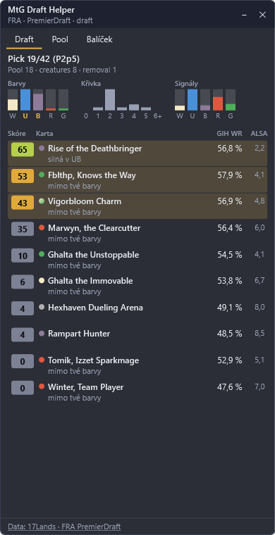
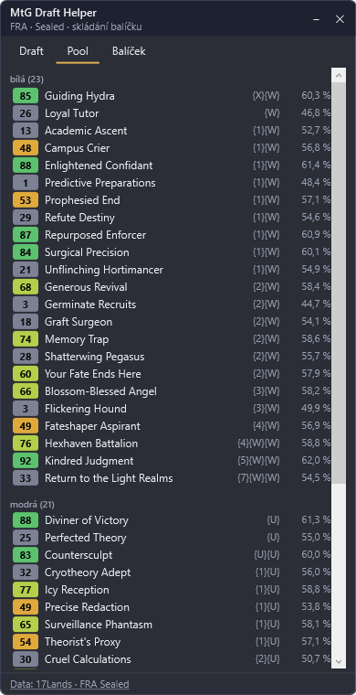

# M3 – Doporučení picků a overlay

*Datum: 2026-11-04*

## Co je hotové

### Doporučování (`src/MtgDraftHelper.Core/Recommendation/`, `Cards/CardRoles.cs`)
- **Role karet** (`CardRoles`): creature, removal, counterspell, combat trick, card draw, fixing, evasion – heuristicky z typu a textu karty.
- **Základní síla** (`CardRatings`): GIH WR vyhlazený k průměru edice (200 her), převedený na percentil v edici → 0–100. Bez dat 17Lands odhad z rarity a rolí.
- **Skóre picku** (`PickRecommender`), složky podle PRD 4.4:

| Složka | Kdy | Rozsah |
|---|---|---|
| Mimo barvy | roste od P1p6 do ~P2p6 podle soustředění poolu | až −30 |
| Archetyp (WR karty v mých dvou barvách vs. všude) | po rozhodnutí o barvách | ±6 |
| Potřeby balíčku (creatures, removal, 2-dropy, moc drahých karet) | od konce P1 | +3 až +5 / −4 |
| Signály (silné karty v balíčku později než jejich ALSA) | P1 a začátek P2; Quick Draft s vlastními daty silněji a déle | −3 až +6 (×1,5 u botů) |

- **Analýza poolu**: síla barev, dvě hlavní barvy, míra rozhodnutí, křivka, počty creatures/removal, signály po barvách.
- Výstup obsahuje zdůvodnění (složky skóre); UI z nich ukazuje 1–2 nejdůležitější.

### Overlay (`src/MtgDraftHelper.App`, WPF)
- Poloprůhledné okno vždy navrchu u pravého okraje obrazovky, přesun tažením za záhlaví, změna velikosti v rohu, sbalení a zavření.
- Záložky **Draft | Pool | Balíček**. Při změně fáze se přepnou samy (draft → Draft, po draftu / Sealed → Pool), jinak zůstává tvoje volba.
- **Draft**: pick X/42, pool a počty, sloupce síly barev (hlavní barvy zvýrazněné), křivka, signály; karty balíčku seřazené podle skóre s GIH WR, ALSA a zdůvodněním, top 3 zvýrazněné.
- **Pool**: karty podle barev a mana cost se skóre a GIH WR.
- **Balíček**: připravené místo pro M4.
- Data 17Lands se stáhnou automaticky při prvním eventu dané edice a formátu (s průběhem ve stavovém řádku), při dalších spuštěních se jen ověří verze. Když dataset formátu chybí, použije se záložní formát a v patičce je to napsané.
- Patička s viditelným odkazem „Data: 17Lands“ (podmínka 17Lands).
- Upozornění, když nejsou zapnuté detailní logy nebo chybí databáze karet.
- Texty UI v `Resources/Strings.cs-CZ.xaml` (překlad = nový slovník).

### Spouštění
- `Directory.Build.props`: `UseAppHost=false` – nevzniká `.exe`, který by Smart App Control blokoval.
- `tools/install-shortcut.ps1`: sestaví Release a vytvoří zástupce **MtG Draft Helper** na ploše (`dotnet.exe … --hide-console`, okno konzole se při startu zavře). Zástupce je vytvořený a ověřený – aplikace se přes něj spustí. Po každé aktualizaci kódu je potřeba skript spustit znovu.
- Vývojářské volby: `--log <cesta>` (jiný log, např. testovací), `--screenshot <png>` (vykreslí okno do obrázku a skončí).

## Ověření

- 99 testů (20 nových: role karet, skóre, mimo barvy, signály u lidí vs. botů, potřeby balíčku, analýza poolu, Pick-Two).
- Overlay spuštěný nad vygenerovaným rozehraným draftem FRA (P2p5) a nad testovacím Sealedem – viz obrázky níže (demo data, ne skutečný draft).
- Spuštění přes zástupce na ploše funguje.

## Neověřeno / další kroky

1. **Váhy skóre nejsou odladěné na skutečném draftu** – to je M6. Postih mimo barvy jsem po prvním náhledu snížil ze 40 na 30.
2. Skutečný draft v Areně overlayem ještě neprošel (parser i UI ověřené jen na testovacích datech).
3. Klávesová zkratka pro skrytí, click-through, průhlednost a zapamatování pozice okna – M5 podle PRD.
4. Aplikace nemá vlastní ikonu (zástupce má ikonu dotnet).
