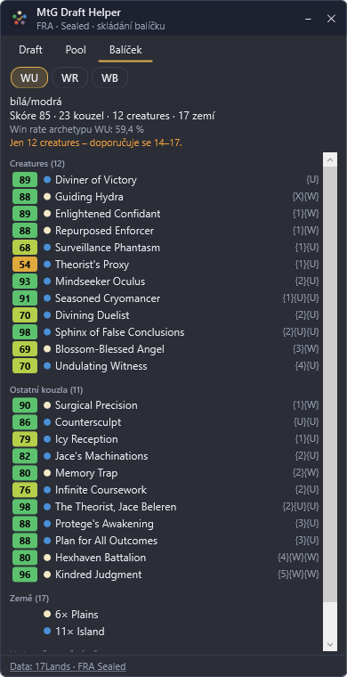

# M4 – Doporučení balíčku

*Datum: 2026-11-04*

## Co je hotové

### Algoritmus (`src/MtgDraftHelper.Core/DeckBuilding/DeckBuilder.cs`)
1. Pro každou z 10 dvojic barev postaví balíček bez splashe a s každým možným splashem.
2. **Hodnota karty** = základní síla (jako u picků) + úprava podle win rate karty přímo v balíčcích dané dvojice (±6).
3. **Výběr**: 23 kouzel s nejvyšší hodnotou (bezbarvé karty se počítají do všech barev), pak výměny:
   - méně než 14 creatures → nejslabší ne-creature za nejlepší creature z lavičky (rozdíl max. 15 bodů),
   - víc než 17 creatures → opačně (max. 5 bodů),
   - víc než 5 karet za 5+ many → levnější náhrada (max. 10 bodů),
   - méně než 4 dvoudropy → výměna za kartu za 4+ (max. 6 bodů).
4. **Agresivní balíček** (průměrná mana value ≤ 2,6 a aspoň 16 creatures) hraje 16 zemí a 24 kouzel, jinak 17 + 23.
5. **Splash** jen pro silné karty (hodnota ≥ 70 po postihu 5 bodů za splash) s jediným symbolem barvy splashe a jen když je v poolu fixing (duální země, fixing kouzla). Max. min(3, fixing + 1) karet. Varianta se splashem se nabídne, jen když balíček opravdu zlepší.
6. **Země**: nezákladní země, které vyrábí aspoň dvě barvy balíčku (max. 3). Základní země podle podílu mana symbolů (hybrid = půl symbolu), každá hlavní barva aspoň 3 zdroje, splash tolik, aby měl s fixingem zhruba 3 zdroje.
7. **Skóre varianty** = průměrná hodnota kouzel + bonus/postih podle win rate archetypu ze 17Lands (±5).
8. **Karty na hraně**: 3 nejslabší karty v balíčku proti 3 nejlepším ze sideboardu, pokud je rozdíl do 8 bodů.
9. Nabídnou se 3 nejlepší varianty s různými hlavními barvami; neúplné balíčky (málo karet v barvách) až za úplnými.

### Overlay – záložka Balíček
- Volba varianty (WU, WR, …), u varianty barvy, splash, skóre, počty kouzel/creatures/zemí a win rate archetypu.
- Seznam creatures, ostatních kouzel a zemí (nezákladní + počty základních), karty podle mana value se skóre.
- Upozornění na neúplný balíček nebo málo creatures; sekce „Na hraně – zvaž výměnu“.
- Balíček se navrhuje průběžně už během draftu (od 15 karet v poolu). Po skončení draftu a u Sealedu se záložka Balíček otevře sama.
- Zástupce na ploše je přestavěný na novou verzi.

## Ověření
- 113 testů (14 nových: výběr dvojice, rozdělení zemí, minimum creatures, 16 zemí u agresivního balíčku, splash jen s fixingem a jedním symbolem, karty na hraně, win rate archetypu, počítání symbolů, barvy zemí).
- Testovací Sealed pool FRA (45 karet): navržený WU balíček 23 + 17 (6 Plains, 11 Island odpovídá poměru symbolů), win rate archetypu WU 59,4 % ze 17Lands Sealed dat.

## Neověřeno / omezení
1. Na skutečném vlastním draftu/Sealedu zatím neověřeno – ladění vah v M6.
2. Návrh je čistě podle síly karet, křivky a počtu creatures; synergie (kmeny, mechaniky edice) nezohledňuje.
3. Výměny v balíčku se neukládají – balíček v Areně skládáš sám, overlay jen radí. Odeslaný balíček z logu se zatím s návrhem neporovnává.
4. Testovací Sealed pool je umělý (prvních 45 karet edice), proto tak vysoké skóre a jen 12 creatures.
