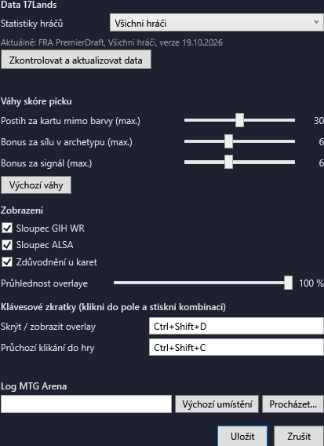

# M5 – Nastavení a ovládání

*Datum: 2026-11-04*

## Co je hotové

### Ovládání overlaye
- **Globální klávesové zkratky** (fungují i s fokusem ve hře):
  - `Ctrl+Shift+D` – skrýt / zobrazit overlay,
  - `Ctrl+Shift+C` – průchozí klikání (click-through): kliky projdou overlayem do Areny. V záhlaví je pak upozornění, jak ho vypnout.
  - Obě zkratky jdou změnit v nastavení. Když zkratku používá jiná aplikace, overlay na to upozorní.
- **Kliknutí na overlay nebere fokus hře** (okno se neaktivuje) – Arena zůstává v popředí.
- **Pozice a velikost okna se pamatují** (uloží se 1 s po přesunu a při zavření). Pokud uložená pozice není na žádné obrazovce (např. odpojený monitor), použije se výchozí u pravého okraje.
- **Průhlednost** 30–100 % (náhled se mění hned při posunu jezdce).

### Okno nastavení (ozubené kolo v záhlaví)
- **Data 17Lands**: skupina hráčů (všichni / top hráči s win rate ≥ 60 %), informace o použitých datech a jejich verzi, tlačítko „Zkontrolovat a aktualizovat data“.
- **Váhy skóre picku**: max. postih mimo barvy (0–60), bonus za archetyp (0–15), bonus za signál (0–15), tlačítko výchozích vah.
- **Zobrazení**: sloupce GIH WR a ALSA, zdůvodnění u karet, průhlednost.
- **Klávesové zkratky**: klik do pole a stisk kombinace (nutný Ctrl/Alt/Shift/Win nebo F1–F24).
- **Log MTG Arena**: vlastní cesta k `Player.log` (nebo výchozí), výběr souboru. Po změně se sledování logu restartuje.

### Uložení
- `%LOCALAPPDATA%\MtgDraftHelper\settings.json` (čitelný JSON). Poškozený soubor nebo hodnoty mimo rozsah se nahradí výchozími.
- Kód: `src/MtgDraftHelper.Core/Settings/` (model, ukládání, parsování zkratek), `src/MtgDraftHelper.App/NativeWindow.cs` (Win32: zkratky, click-through, neaktivující okno), `SettingsWindow.xaml`.

## Ověření
- 128 testů (15 nových: ukládání a načítání nastavení, poškozený soubor, normalizace hodnot, parsování a formátování zkratek).
- Spuštěná aplikace: registrace obou zkratek proběhla, simulovanou zprávou zkratky se overlay skryl a znovu zobrazil a přepnul do click-through; okno má příznak „neaktivovat“.
- Uložení pozice okna do `settings.json` ověřeno.
- Zástupce na ploše přestavěný na novou verzi.

## Zjištění: Smart App Control blokuje i některé .dll

Release sestavení `MtgDraftHelper.Core.dll` Smart App Control zablokoval (událost CodeIntegrity 3033/3077), Debug sestavení stejného kódu ne. Smart App Control posuzuje každý nepodepsaný soubor zvlášť podle cloudové reputace, takže **kterékoli budoucí sestavení může být zablokované** – spouštění přes `dotnet.exe` (varianta 1) tedy problém neřeší spolehlivě.

Provedená opatření:
- `tools/install-shortcut.ps1` sestavuje Debug (ten teď projde) a po sestavení aplikaci zkušebně spustí. Když ji Smart App Control zablokuje, skript skončí s chybou a zástupce nepřepíše.
- Dlouhodobé řešení je potřeba rozhodnout (podepsání certifikátem, nebo vypnutí Smart App Control) – viz PRD 6.

## Neověřeno
1. Skutečné stisknutí zkratek při hraní v Areně (simulace šla přímo do okna overlaye).
2. Chování overlaye nad Arenou v bezrámečkovém režimu (fokus, click-through) – ověří se při prvním draftu (M6).
